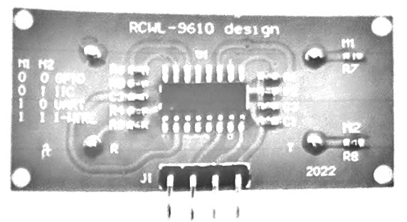
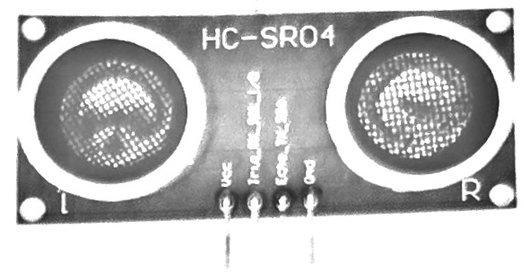
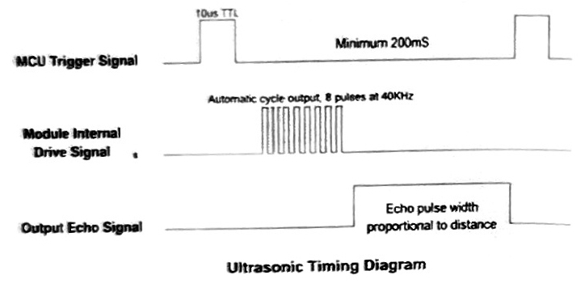
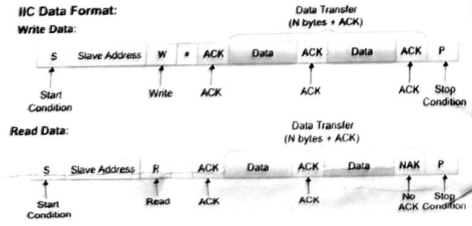
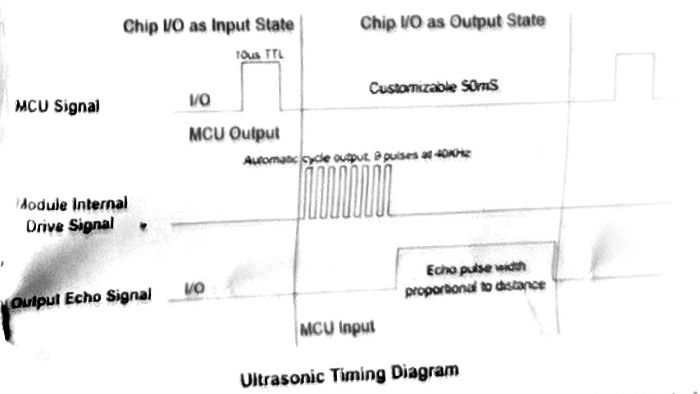

<!-- HTML tables preserve the scanned leaflet's approximate two-column layout in Markdown viewers that support inline HTML. Keep the adjacent images directory with this file. -->

<table>
<tr>
<td width="50%" valign="top">
<h1>ULTRASONIC DISTANCE SENSOR</h1>
<h2 align="center">HC-SR04 Compatible</h2>

<strong>4 Interface Modes · High Accuracy 2.8V–5.5V Wide Voltage · Easy to Integrate</strong>

<h3>INTERFACE DEFINITION</h3>
<table>
<tr><th>No.</th><th>Interface</th><th>Description</th></tr>
<tr><td>1</td><td>Vcc</td><td>Power Supply</td></tr>
<tr><td>2</td><td>Trig/Rx/SCL</td><td>GPIO Mode: <b>Trig</b> — Trigger Signal UART Mode: <b>Rx</b> — Receive Signal IIC Mode: <b>SCL</b> — Clock Signal</td></tr>
<tr><td>3</td><td>Echo/Tx/SDA</td><td>GPIO Mode: <b>Echo</b> — Echo Signal UART Mode: <b>Tx</b> — Transmit Signal IIC Mode: <b>SDA</b> — Data Signal</td></tr>
<tr><td>4</td><td>Gnd</td><td>Ground</td></tr>
</table>
<h3>MODE SELECTION</h3>
<table>
<tr><th>No.</th><th>Mode</th><th colspan="2">R4/R5 Resistor Configuration</th><th></th></tr>
<tr><td>1</td><td>GPIO</td><td>R4=NC</td><td>R5=NC</td><td>(Default)</td></tr>
<tr><td>2</td><td>UART</td><td>R4=NC</td><td>R5=10K</td><td></td></tr>
<tr><td>3</td><td>IIC</td><td>R4=10K</td><td>R5=NC</td><td></td></tr>
</table>
</td>
<td width="50%" valign="top">

<table>
<tr><td><strong>Four Interface Modes:</strong> 1. GPIO 3. IIC 3. UART Serial Port 4. 1-WIRE Single Bus</td><td><strong>2.8V–5.5V</strong>  <strong>Default Compatible with HC-SR04</strong></td></tr>
</table>
</td>
</tr>
<tr>
<td width="50%" valign="top">
<h3>1. GPIO Mode</h3>

This mode is the same as HC-SR04. The external MCU sends a trigger pulse of more than 10us to the Trig pin; the module will output a high-level pulse proportional to the distance, and the pulse width T can be used to calculate the distance:

<strong>Distance = T * C / 2</strong> &nbsp; (C is the speed of sound)

Speed of sound formula: <strong>c = (331.45 + 0.61 * t / °C) m/s</strong> <em>(where 330.45 is at 0°C)</em>

Sound speed at 0°C: &nbsp; 330.45 m/s Sound speed at 20°C: &nbsp; 342.62 m/s Sound speed at 40°C: &nbsp; 354.85 m/s

The error of sound speed from 0°C to 40°C is about ±7%. In practical applications, temperature compensation should be considered if high accuracy is required.

</td>
<td width="50%" valign="top">
<h3>2. UART Mode</h3>

<strong>UART Mode Baud Rate Setting: &nbsp; 9600 N 1</strong>

<table>
<tr><th>Command</th><th>Return Value</th><th>Description</th></tr>
<tr><td>0xA0</td><td>BYTE_H BYTE_M BYTE_L</td><td>Distance (mm): <code>((BYTE_H &lt;&lt; 16) + (BYTE_M &lt;&lt; 8) + BYTE_L) / 1000</code> Unit: mm</td></tr>
<tr><td>0xF1</td><td>—</td><td>Company and version information</td></tr>
</table>

Connect the serial port. After the external MCU or PC sends command 0xA0, the module will return 3 distance data bytes: BYTE_H, BYTE_M, and BYTE_L.

Distance calculation (unit: mm):

<strong>Distance = ((BYTE_H &lt;&lt; 16) + (BYTE_M &lt;&lt; 8) + BYTE_L) / 1000</strong>

 

<strong>✦ Fortune Cookie: May your logic never fail, and may you always navigate around life's obstacles. ✦</strong>

</td>
</tr>
<tr>
<td width="50%" valign="top">
<h3>3. IIC Mode</h3>

<strong>IIC Address: &nbsp; 0x57 IIC Data Format:</strong>

<strong>Command Format:</strong>

<table>
<tr><th>Address</th><th>Command</th><th>Return Value</th><th>Description</th></tr>
<tr><td>Write Address 0xAE</td><td>0x01</td><td>—</td><td>Start measurement command</td></tr>
<tr><td>Read Address 0xAF</td><td></td><td>BYTE_H BYTE_M BYTE_L</td><td>Distance (mm): <code>((BYTE_H &lt;&lt; 16) + (BYTE_M &lt;&lt; 8) + BYTE_L) / 1000</code> Unit: mm</td></tr>
</table>

Write command 0x01 to start measurement, then wait for at least 200ms (maximum measurement time of the module). Then read 3 distance data bytes, BYTE_H, BYTE_M, and BYTE_L.

Distance calculation (unit: mm):

<strong>Distance = ((BYTE_H &lt;&lt; 16) + (BYTE_M &lt;&lt; 8) + BYTE_L) / 1000</strong>

</td>
<td width="50%" valign="top">
<h3>4. 1-WIRE Bus Mode</h3>

The external MCU initializes the module as output, and the module I/O pin is held high for more than 10us. after the echo space signal is output, the MCU sets the pin as input mode and waits for the module to output a high-level pulse proportional to distance; after measurement is completed, the MCU sets the pin back to output mode for the next measurement. The speed of sound can be calculated from the pulse width “T” as shown below:

<strong>Distance = T * C / 2</strong> &nbsp; (C is the speed of sound)

Speed of sound formula: <strong>c = (331.45 + 0.61 * t / °C) m/s</strong> <em>(where 330.45 is at 0°C)</em>

Sound speed at 0°C: &nbsp; 330.45 m/s Sound speed at 20°C: &nbsp; 342.62 m/s Sound speed at 40°C: &nbsp; 354.85 m/s

</td>
</tr>
</table>

---

*Transcribed from the scanned leaflet. Original numbering and numerical inconsistencies are preserved. The two-column layout requires a Markdown viewer with HTML table support.*

[Original full-page scan](images/page-001-image-001.jpg) · [Plain-text transcription](text.txt)
